# Calm UI screenshots (branch ui/tame-revamp, 2026-11-12)

Captured in Chromium with the fake-gateway harness at 360/460 px side panel width.

## Before / after

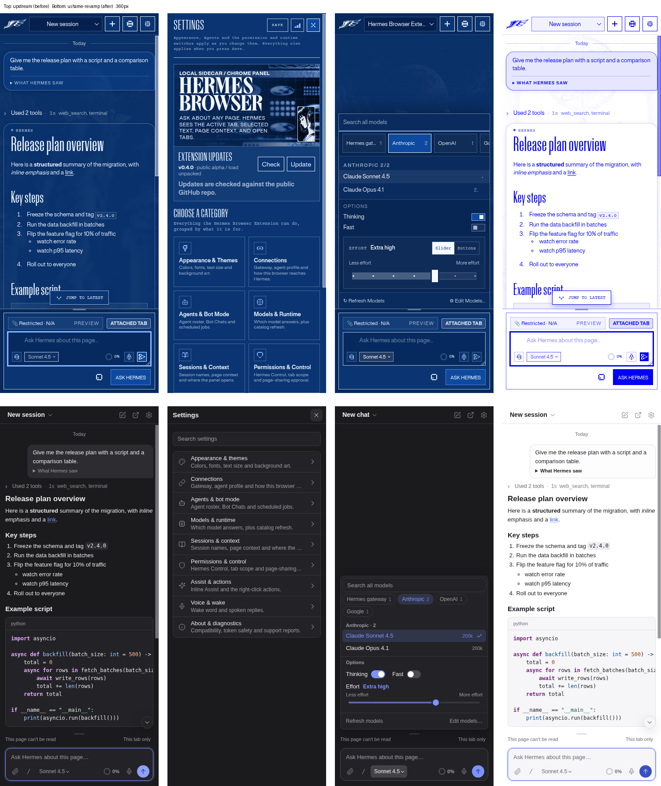

## attach-menu-360-light

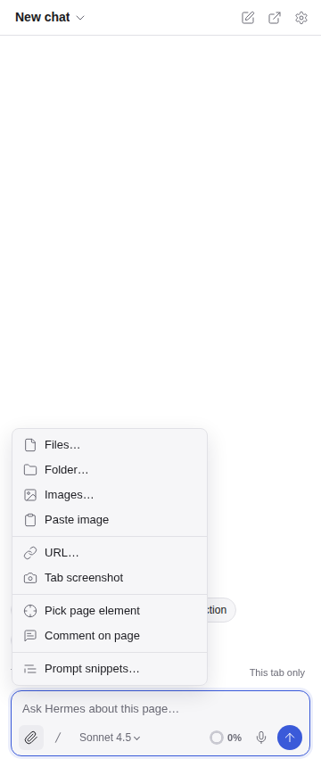

## chat-empty-360-dark

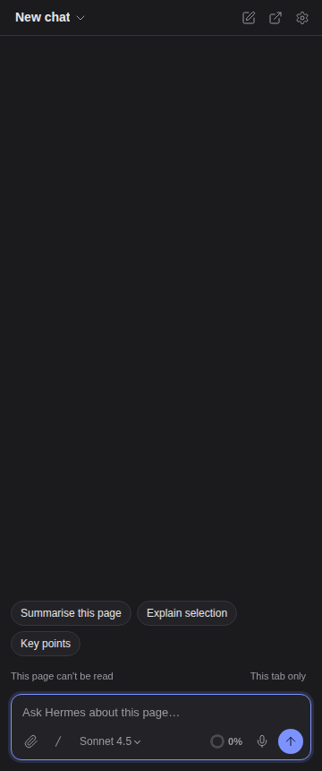

## chat-long-top-360-dark

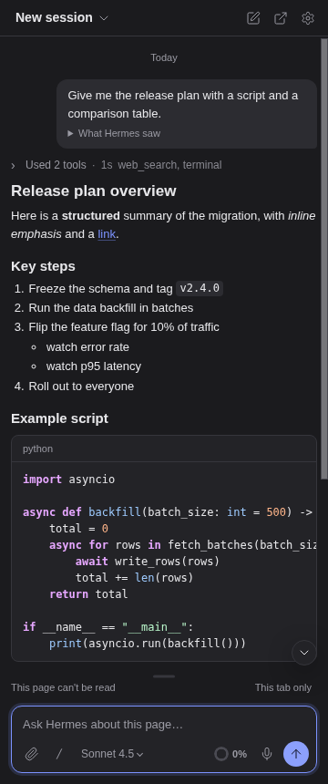

## chat-long-top-460-light

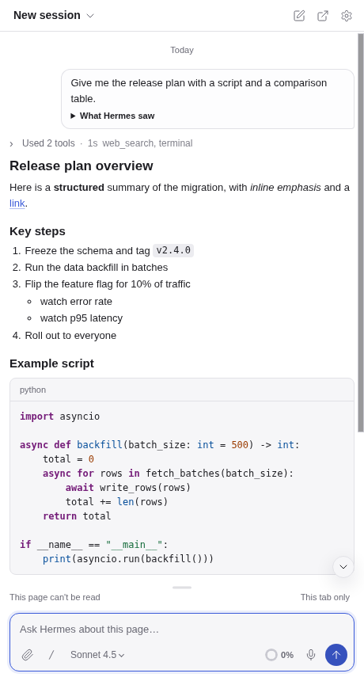

## composer-typed-460-light

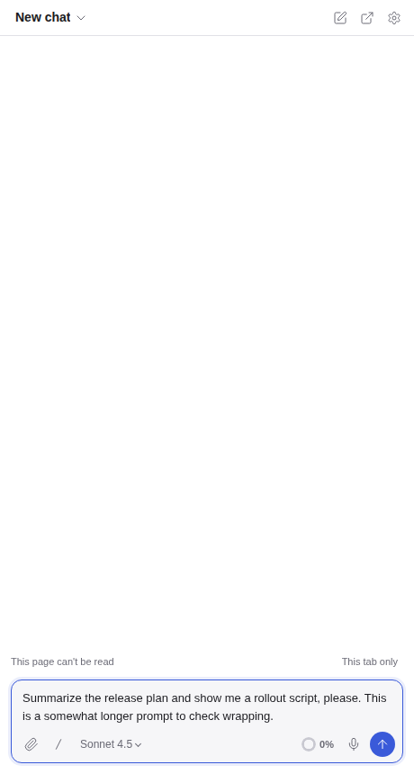

## error-gateway-down-360

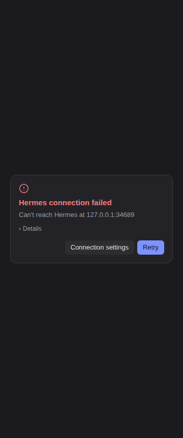

## model-picker-360-dark

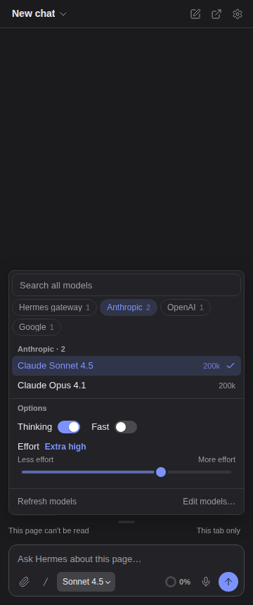

## onboarding-first-360

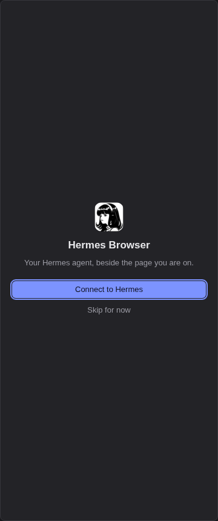

## quick-commands-360-dark

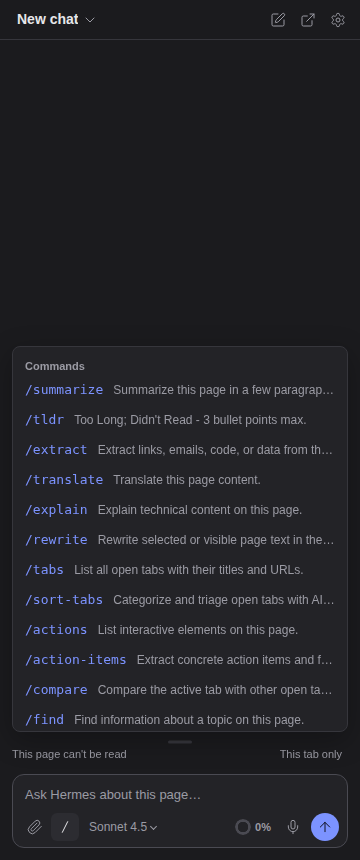

## sessions-list-360-dark

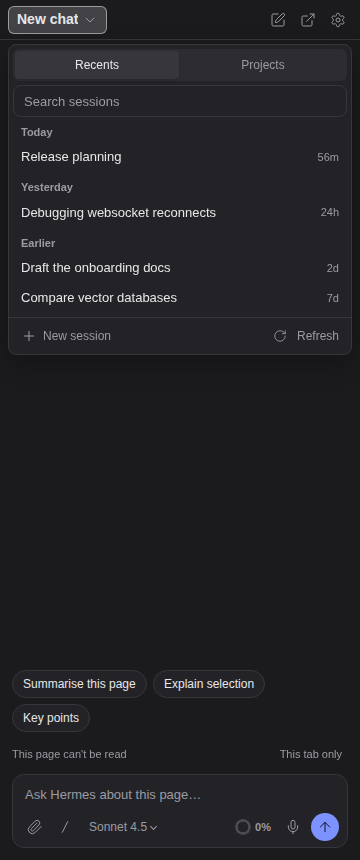

## settings-about-360-dark

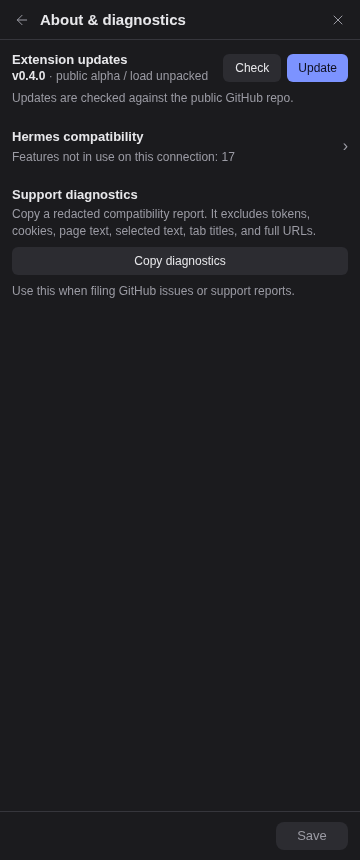

## settings-appearance-360-light

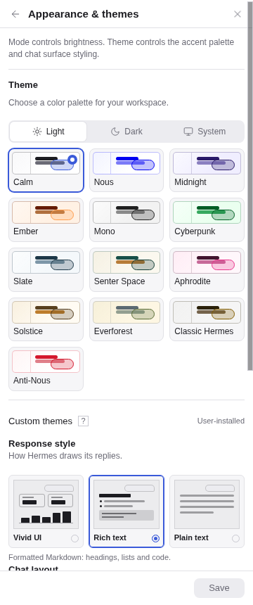

## settings-connections-360-dark

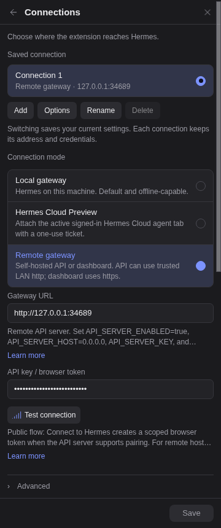

## settings-home-360-dark

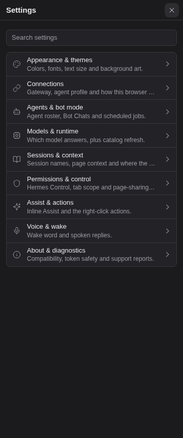

## settings-models-360-dark

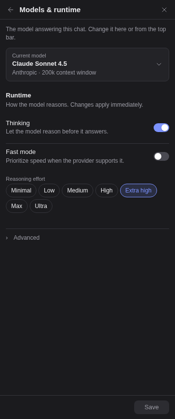

